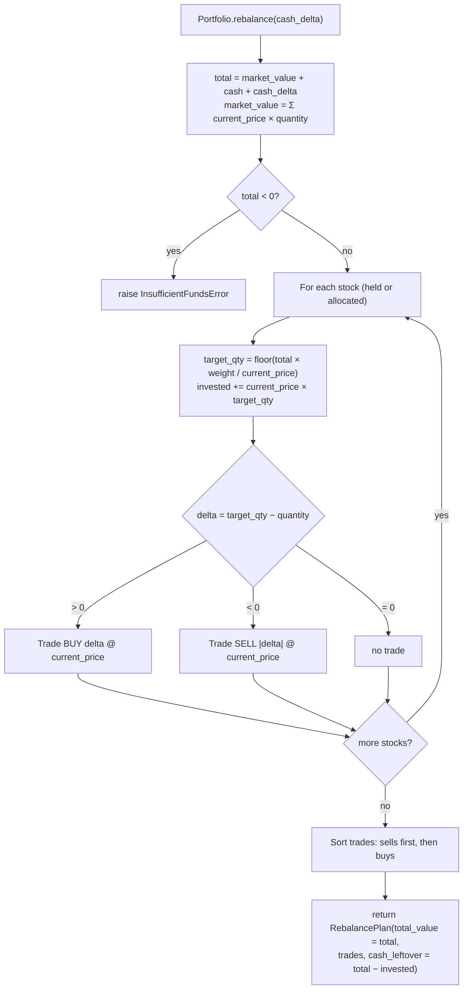
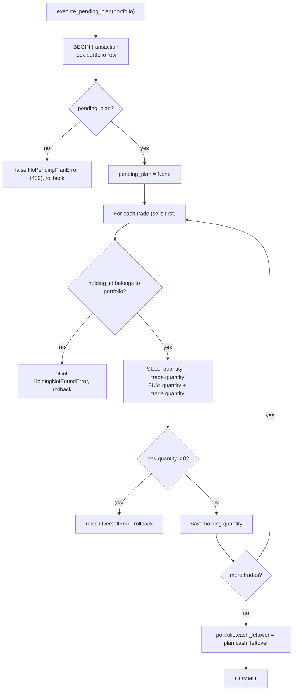

# PoC Stock Portfolio

[](https://github.com/nicoaravena/stock-portfolio/actions/workflows/ci.yml)

This is a PoC that solves these 4 points:

- You’re building a portfolio management module, part of a personal investments and trading app
- Construct a simple Portfolio class that has a collection of Stocks. Assume each Stock has a “Current Price” method that receives the last available price. Also, the Portfolio class has a collection of “allocated” Stocks that represents the distribution of the Stocks the Portfolio is aiming (i.e. 40% META, 60% APPL)
- Provide a portfolio rebalance method to know which Stocks should be sold and which ones should be bought to have a balanced Portfolio based on the portfolio’s allocation.
- Add documentation/comments to understand your thinking process and solution

**TL;DR:** `Portfolio.rebalance()` pools the market value and cash, gives each stock `floor(total x weight / price)` whole shares, and returns the difference as trades, sells first.
Rounding down means the buys never cost more than the money available; the price is some uninvested cash. The rules are plain Python; a small Django API around them shows the module working end to end.

**Where to look:**

- `src/stock_portfolio/domain/portfolio.py` - the `Portfolio` class and `Portfolio.rebalance()`
- `src/stock_portfolio/domain/stock.py` - the `Stock` class and `Stock.current_price()`
- `tests/domain/` - the rebalance rules as executable examples (no database needed)

## Project structure

```text
src/stock_portfolio/
|-- domain/                  # the module the challenge asks for: plain Python, no framework imports
|   |-- portfolio.py         # Portfolio, Portfolio.rebalance(), RebalancePlan, Trade, Action
|   |-- stock.py             # Stock and Stock.current_price()
|   |-- prices.py            # PriceProvider protocol and PriceSnapshot (fixed prices)
|   └── errors.py            # domain exceptions (PortfolioError, NotFoundError, ...)
└── api/                     # Django app: persistence and HTTP, built around the domain
    |-- models.py            # ORM tables: Stock, Portfolio, Holding
    |-- schemas.py           # Ninja/Pydantic request and response shapes
    |-- services.py          # use cases: map models <-> domain, rebalance, execute trades
    |-- views/               # thin HTTP handlers; __init__.py maps errors to 404/409/422
    |-- migrations/          # generated by Django
    └── settings.py, urls.py, wsgi.py
tests/
|-- domain/                  # unit tests for the rules, no database; test_purity.py keeps the domain framework-free
└── api/                     # models, schemas, services and endpoints, against a test database
cartero/                     # API tour: numbered requests for the Cartero HTTP client
manage.py                    # Django entry point (migrate, runserver)
Dockerfile                   # container image for the API
.github/workflows/ci.yml     # lint (ruff), type check (ty) and tests with coverage
```

Dependencies point inward: `views` -> `services` -> `domain`. The domain never imports from `api`, so the rebalance rules can be read and tested without Django.

## Domain model

The domain (`src/stock_portfolio/domain/`) is plain Python: no Django, Ninja or Pydantic imports (a test enforces it). The HTTP API is a thin layer on top of it.

- **`Stock`** - identified by its symbol. `current_price()` returns the last available price by asking an injected **`PriceProvider`**. The stock does not store a price, so the same class works with prices from the database, a market-data feed, or a fixed `PriceSnapshot` in tests.
- **`Portfolio`** - two separate collections, as an investor thinks about them:
  - `holdings`: what is owned now, in whole shares per stock.
  - `allocation`: what the portfolio is aiming for, as target weights (fractions of the total value, e.g. META `0.4`, AAPL `0.6`) that must sum to exactly 1.
  A stock held but not allocated is sold fully; a stock allocated but not held is bought from zero. `cash` is money in the portfolio that is not invested.
- **`RebalancePlan`** - the result of `Portfolio.rebalance(cash_delta)`: the total value, the trades (sells first, then buys) and the cash left over.

The API stores allocations as integer percents (`40`, `60`) and converts them to fractions (`0.4`, `0.6`) when it builds the domain `Portfolio` (`services.to_domain()`).

## Assumptions

- "A Current Price method that receives the last available price" is read as: `current_price()` *fetches* the last available price from a price source, rather than taking a price as an argument. The stock stays a plain identity, and the price source can be swapped (database, market feed, test snapshot) without changing `Stock`.
- Stock prices are updated manually through the API.
- Only whole shares are traded (rounds down to the nearest whole share).
- A rebalance can add or remove cash; it is pooled with the portfolio value before computing targets.
- The price of each trade is saved in the plan and used when the plan is executed.
- Executing a plan does not check whether the stock price changed since the plan was made.

## Design decisions & trade-offs

- **Domain first, API around it.** The challenge asks for a class; the rules live in a framework-free `Portfolio`. The REST API (Django + Django Ninja, SQLite) exists to show the module working end to end inside an app: persistence, validation and an interactive Swagger UI.
- **Whole shares, rounded down.** Target quantities are floored, so buys never cost more than the money available. The price of that safety is some uninvested cash, reported as `cash_leftover`.
- **Sells before buys.** Selling first frees the cash the buys need, so a plan never needs credit.
- **Plan, then execute.** `rebalance` stores the plan on the portfolio and `execute-trades` applies it in one transaction. This lets the user review trades before acting. Execution trusts the planned prices; a real broker integration would re-quote or use limit orders.
- **Leftover cash is not reinvested.** A greedy second pass could spend the leftover on more shares (see the worked example). Kept out to keep the rule simple and predictable.
- **No drift tolerance.** Every rebalance trades to the exact target, even for tiny differences. A threshold ("only trade if off by more than X%") would avoid small, costly trades.
- **Domain errors, mapped at the edge.** The domain raises specific exceptions (`InsufficientFundsError`, `OversellError`, `StockNotFoundError`, ...); only the HTTP layer turns them into 404/422. Any other error stays a 500 instead of hiding behind a validation error.
  Where a response message is part of the API contract (e.g. too much cash removed), the HTTP layer owns its wording, so the domain speaks in domain terms.
- **Out of scope:** fees, taxes, fractional shares, live market prices, multi-currency.

## Worked example

META costs 510 and AAPL 200. The portfolio holds 2 META and 0 AAPL, targets 40% META / 60% AAPL, and the owner adds 1000 cash:

| Step | META | AAPL |
|---|---|---|
| Total value | 2 x 510 + 1000 = 2020 | |
| Target value | 2020 x 0.4 = 808 | 2020 x 0.6 = 1212 |
| Target shares (floor) | 808 / 510 = 1.58 -> 1 | 1212 / 200 = 6.06 -> 6 |
| Trade | SELL 1 | BUY 6 |

Invested: 510 + 1200 = 1710, so `cash_leftover` = 310. That leftover could buy one more AAPL share; see "Leftover cash is not reinvested" above. The same example is a test (`tests/domain/test_portfolio.py::test_rebalance_worked_example`) and a request in the API tour (`cartero/18-rebalance.cartero`).

## Rebalance logic

The logic is implemented in `Portfolio.rebalance()` (`src/stock_portfolio/domain/portfolio.py`).

`Portfolio.rebalance(cash_delta)` returns a `RebalancePlan`, based on the following logic:

1. Request a rebalance for a specific portfolio (optionally add or remove cash).
2. Calculate the total, using the market value, the portfolio's uninvested `cash` and the optional `cash_delta`.
    - The market value is the sum of `stock.current_price()` times the quantity held, for every holding.
3. Only if the total is greater than or equal to 0, redistribute it based on the allocation weights.
4. After getting the new quantities of the holdings, check the amounts required to buy, sell or maintain.
5. Finally sort the trades to have first the sell and then the buy actions to be used in the execution.

The logic is translated in the code as this flowchart:



`services.execute_pending_plan(portfolio)` applies the pending plan in a single transaction, with the following logic:

1. A request triggers the execution of a rebalance plan in a portfolio.
2. The portfolio row is locked and the plan is read and cleared, so the plan is executed at most once: a concurrent request waits for the lock, then finds no plan (409).
3. The trades are executed one by one without being committed (`execute_trade_plan`).
4. When no trades are left and no errors occurred, the transaction is committed. On an error, everything is rolled back, including the cleared plan.

The logic is translated in the code as this flowchart:



## HTTP API (Django + Django Ninja, SQLite)

```bash
uv sync
uv run python manage.py migrate      # creates ./db.sqlite3
uv run python manage.py runserver    # Swagger UI at http://127.0.0.1:8000/api/docs
```

| Method | Path | Body |
|---|---|---|
| GET/POST | `/api/stocks` | `{"symbol": "META", "last_price": "500"}` |
| GET/PUT/DELETE | `/api/stocks/{symbol}` | PUT: `{"last_price": "510"}` |
| GET/POST | `/api/portfolios` | `{"name": "main", "holdings": [{"symbol": "META", "quantity": 2, "allocation": 40}, {"symbol": "AAPL", "allocation": 60}], "cash_leftover": "0"}` |
| GET/PUT/DELETE | `/api/portfolios/{id}` | PUT: same as POST (full replace) |
| POST | `/api/portfolios/{id}/rebalance` | `{"cash": "1000"}` (optional, may be negative) |
| POST | `/api/portfolios/{id}/execute-trades` | – |

- Stocks must exist before they are used in a portfolio. `quantity` and `allocation` default to 0; allocations must sum to 100 and a 0% holding is sold fully on rebalance.
- `rebalance` stores the plan on the portfolio (`pending_plan`), only if no plan is pending. `execute-trades` applies it and clears it. Both hold under concurrent requests: one rebalance stores its plan and one execution applies it, the others get 409. Updating a portfolio discards the pending plan.
- SQLite runs in `IMMEDIATE` transaction mode because it ignores row locks (`select_for_update`): write transactions run one at a time.
- A stock held by a portfolio can't be deleted (409). Unknown stocks or holdings return 404; domain rule violations return 422.

### API tour

`cartero/` holds a request collection for [Cartero](https://cartero.danirod.es/) (a desktop HTTP client). Open the folder in Cartero and run the requests in numeric order against a fresh database: each file starts with a comment saying the expected status and result, from creating stocks to rebalancing (the worked example above) and executing the trades.
