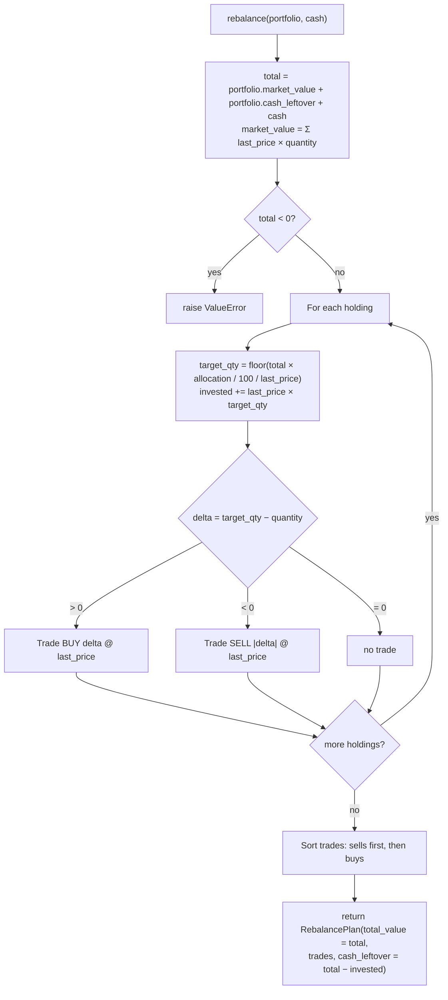
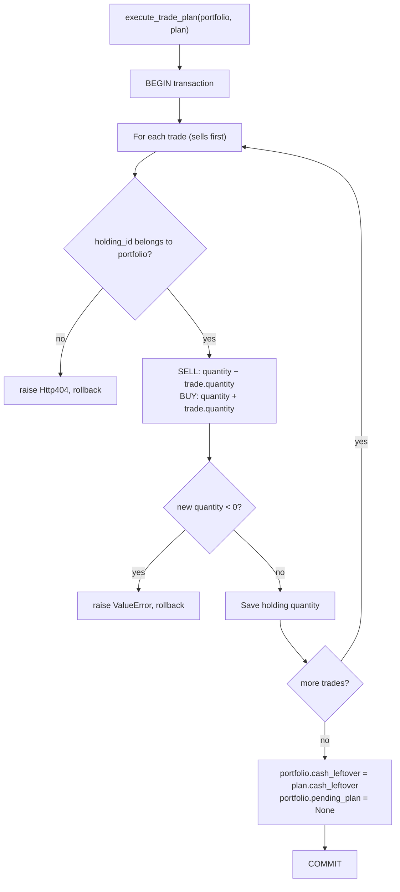

# PoC Stock Portfolio

This is just a PoC to solve this 3 points:

- You’re building a portfolio management module, part of a personal investments and trading app
- Construct a simple Portfolio class that has a collection of Stocks. Assume each Stock has a “Current Price” method that receives the last available price. Also, the Portfolio class has a collection of “allocated” Stocks that represents the distribution of the Stocks the Portfolio is aiming (i.e. 40% META, 60% APPL)
- Provide a portfolio rebalance method to know which Stocks should be sold and which ones should be bought to have a balanced Portfolio based on the portfolio’s allocation.

## Assumptions

- Portfolio rebalancing logic implemented in `services.rebalance()`
- The price of the stocks are manually updated.
- The price of a holding to be traded (sell/buy) is saved in the Trade model to be used in the execution of the rebalance.
- Portfolio plan execution logic implemented in `services.execute_trade_plan()`
- The execution of the rebalance plan does not check if the stock price differ with the one saved for trade.
- Only whole shares are traded (rounds down to nearest whole share).
- A rebalance could add or remove cash to the portfolio to be computed in the process.

## Rebalance logic

The logic is implemented in `src/stock_portfolio/api/services.py`.

`rebalance(portfolio, cash)` returns a `RebalancePlan`, based on the following logic:

1. request a rebalance for a specific portfolio (optionally add or remove cash)
2. Calculate the total cash, using the `portfolio.market_value`, `portfolio.cash_leftover` and the optional cash value.
    - The `portfolio.market_value` is the sum of the `holding.stock.last_price` times `holding.quantity` that are contained in the portfolio.
3. Only if the total is greater or equal to 0 redistributes the holdings based on the allocations of each holding.
4. After the getting the new quantities of the holdings, check the amounts required to buy, sell or maintain.
5. Finally sort the trades to have first the sell and the the buy actions to be used in the execution.

The logic is translated in the code as this flowchart:

`execute_trade_plan(portfolio, plan)` applies the plan in a single transaction, with following logic:

1. A request triggers the execution of a rebalance plan in a portfolio
2. The trades are executed one by one without being committed.
3. When no trades left and no errors occurred, the transactions are committed.

The logic is translated in the code as this flowchart:

